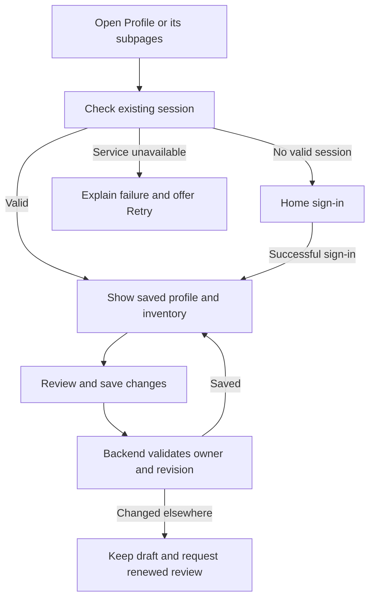

# Profile, Inventory and Preferences

**Status**: Ready for canvas review · **Date**: 2026-11-14

## Outcome

Provide a signed-in member with `/profile` to edit their public profile, manage their inventory, and adjust private trading preferences. A visitor without a valid session goes to `/home` to sign in. Main navigation becomes **Home · Profile · Trade**.

This implements the user's route direction and builds on FR-001 (accounts/saved information), FR-002 (profile), FR-003 (inventory), FR-006 (preferences), FR-028 (accessible interactions), and FR-030 (privacy). Existing trade and item rules remain authoritative in the backend.

## Pages and navigation

| URL | Content |
|---|---|
| `/home` | Public welcome and username/password sign-in; an existing-account registration form can be selected on the same page. Signed-in members get a Profile link. |
| `/profile` | Account overview and editable display name/community; username is read-only. |
| `/profile/inventory` | Existing inventory list and draft/edit/photo/publication controls. |
| `/profile/preferences` | Interests, exclusions, value-gap limit and reviewed interpretation suggestions. |
| `/trade` | Existing discovery screen. |
| `/trade/offers` | Existing proposals, history, notes and handoff controls. |

Profile has internal **Account · Inventory · Preferences** navigation. Trade has **Discover · Offers** navigation. The shared cream/black theme, controls, responsive layout and bundle presentation are retained.

`/` redirects to `/home`. Existing `/inventory`, `/preferences`, `/discover` and `/trades` redirect to their canonical destinations. `/login` and `/register` lead to the corresponding form on `/home`. Only Home, Profile and Trade remain primary navigation sections.

## Session and access flow

- Bootstrap `/api/me` automatically. Show a real checking state before private content. Only an authentication failure means signed out; an outage shows Retry rather than an incorrect login redirect.
- After sign-in, load the saved member and return to the requested internal destination, default `/profile`. Accept only known local destinations; never arbitrary external return URLs.
- Protect Profile and Trade routes, including direct links and full-page reloads. Backend authorization continues to enforce every read/write; frontend guards control presentation.
- Logout or an expired session clears private snapshots, forms, selections, interpreted text and pending user command state, then returns Home. Ignore delayed responses from a previous session/account.
- Fictional seed profiles never satisfy authentication. Keep the seed flag clearly labeled and prevent it from granting access or pretending to save a real profile; authenticated flows are verified with seed mode disabled.

## Profile and inventory editing

- Separate the account form from trading preferences. The existing profile endpoint requires all editable fields, so each save preserves saved fields belonging to the other section and includes the reviewed revision.
- Keep drafts stable across Profile navigation and unrelated inventory operations. Explicit reset/reload or a successful relevant save may replace them; an error must not silently erase input.
- Provide labels, required/length/range validation, save progress, field/action errors and success messages. Stale edits keep draft input and explain how to reload/review current values.
- Reuse existing inventory rules: drafts can be incomplete, publication requires reviewed fields/photo, unknown comparison values remain distinct, and reserved items cannot be edited or removed.
- Route changes must preserve recommendation-to-proposal composition and existing trading controls. No new payment, valuation, ranking or commitment behavior is added.
- Avatar, biography, password changes, notifications and account deletion are outside this change.

## Implementation boundaries

1. **Session and state** — update the workspace provider/transport helpers with bootstrap, explicit session states, login/logout, reset and stale-response protection.
2. **Profile screens** — extract reusable inventory/preferences presentations; add the protected Profile layout and account form without duplicating page code or full-profile overwrite bugs.
3. **Home and routes** — add real Home authentication forms, top/internal navigation, canonical routes and legacy redirects; move existing Trade presentations under `/trade`.
4. **Verification and guides** — add focused regression evidence, update current-route/session documentation, and record results by storage/provider mode. Existing custom checklist markers remain unchanged.

Use the current implemented API conventions (`expected_revision`, cookie authentication and application request header). Record the route/session design change in feature documentation; no persistence migration, new cloud resource or live AI call is required.

## Acceptance and verification

| Scenario | Required outcome |
|---|---|
| Anonymous direct Profile/subpage link | No private form flash; Home sign-in follows session resolution. |
| Existing valid cookie / refresh | Requested Profile subpage restores saved identity automatically. |
| Login/registration failure or outage | Actionable errors; no false signed-in state; entered non-secret form data preserved. |
| Bootstrap outage | Retry state, not a claim that the member is signed out. |
| Account/preference save | Correct fields persist; other section's saved values remain intact. |
| Stale profile/item or unauthorized operation | Rejected accurately; draft preserved for review. |
| Logout, expiry or account switch | Prior private data/drafts disappear; late responses cannot restore them. |
| Inventory and trade navigation | Existing edit/publication and discovery-to-offer flows remain usable at canonical URLs. |
| Keyboard and 390px layout | Clear focus, labels, announced status/errors and no horizontal page overflow. |

Run frontend typecheck/build and the relevant backend domain/API regressions. Add meaningful checks for session classification, redirect destinations and section-preserving saves; exercise the flows in a browser with synthetic accounts and explicitly temporary storage. Missing installed dependencies must be resolved or reported accurately. Real Atlas persistence, live Gemini/Bedrock, and full pilot acceptance are separate evaluations.

## Review decision

Approve to implement this scope, or annotate a specific page/flow to request changes. No application code has been changed while preparing this plan.
